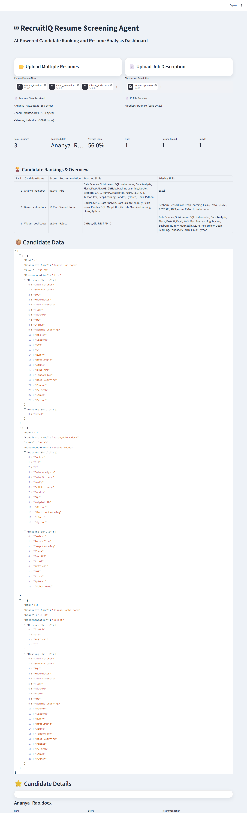
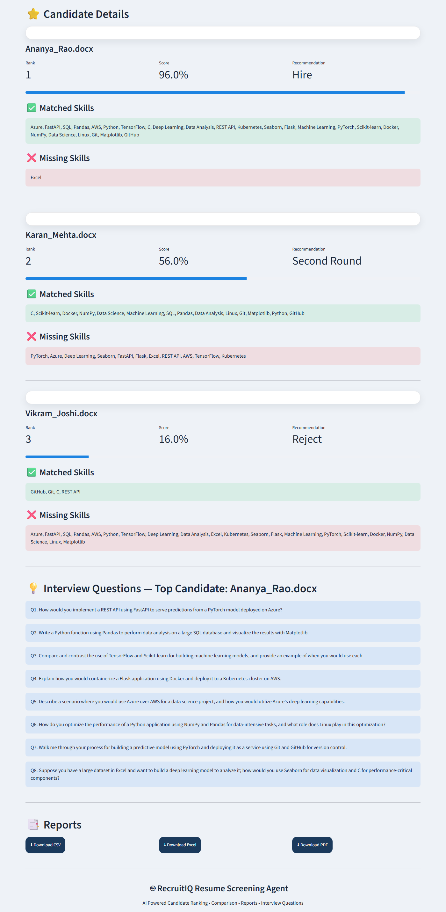

# RecruitIQ - AI Resume Screening Agent

RecruitIQ is an AI-powered Resume Screening Agent built using Python and Streamlit.





## Features

- Upload multiple resumes
- Upload job descriptions
- Resume parsing
- Skill extraction
- Candidate matching
- Candidate ranking
- Resume comparison
- Recommendation engine (Hire / Second Round / Reject based on match score)
- AI-generated interview questions for the top-ranked candidate (Groq, with Gemini as fallback)
- Scorecards
- CSV report generation
- Excel report generation
- PDF report generation
- Clean, professional dashboard theme

## Recommendation Thresholds

- **Hire** — score >= 70
- **Second Round** — score >= 50 and < 70
- **Reject** — score < 50

## Project Structure

```text
RecruitIQ

streamlit_app.py       # Streamlit UI and page flow
main.py                # Orchestrates parsing, scoring, and ranking

agents/
    parser_agent.py         # Resume/JD text extraction (PDF, DOCX, TXT)
    skill_extractor.py       # Skill matching against data/skills_database.py
    scoring_agent.py         # Candidate score calculation
    recommendation_agent.py  # Hire / Second Round / Reject logic
    interview_agent.py       # AI-generated interview questions (Groq/Gemini)
    scorecard_agent.py       # Per-candidate scorecard JSON generation
    report_agent.py          # CSV/Excel/PDF report generation

data/
    skills_database.py       # Single source of truth for recognized skills
    question_bank.py         # Fallback interview questions by skill

tests/                  # pytest unit tests for scoring/recommendation/skills
resumes/                # Uploaded resumes land here at runtime (gitignored)
reports/                # Generated CSV/Excel/PDF reports (gitignored)
scorecards/             # Generated per-candidate scorecards (gitignored)

requirements.txt        # Runtime dependencies
requirements-dev.txt     # Adds test tooling (pytest) on top of requirements.txt
README.md
```

## Installation

```bash
pip install -r requirements.txt
```

For development (adds pytest for running the test suite):

```bash
pip install -r requirements-dev.txt
```

## Tests

```bash
pytest tests/ -v
```

## Configuration

Copy `.env` and set your API keys for AI-generated interview questions (optional — the app falls back to a built-in question bank if these aren't set):

```text
GROQ_API_KEY=your_groq_api_key
GROQ_MODEL=llama-3.3-70b-versatile
GEMINI_API_KEY=your_gemini_api_key
GEMINI_MODEL=gemini-2.0-flash
```

Interview question generation tries Groq first, then Gemini, then falls back to a static question bank if neither is configured or both fail.

## Run

```bash
streamlit run streamlit_app.py
```

## Technologies

- Python
- Streamlit
- Pandas
- PyMuPDF (PDF text extraction)
- Python-docx
- ReportLab
- Groq API / Gemini API (AI-generated interview questions)
- Pytest (unit tests)

## License

MIT License — see [LICENSE](LICENSE) for details.

## Author

Aashiya Arab
